# Benchmarks

These cases are dummies. They exist to show what a report looks like.

- Commit: `ca5d10f-dirty`
- Run: 2026-11-25T12:11:25Z, 5 rounds, seed 3780048036447800936
- TSC: 2.688 GHz, invariant
- Figures: nanoseconds per op, the median across repetitions and their range

## Warnings

- Repetitions that moved CPU: `demo_spin_1` 3 of 5, `demo_spin_10` 2 of 5, `demo_spin_100` 1 of 5, `demo_spin_100k` 4 of 5, `demo_spin_10k` 4 of 5, `demo_spin_1k` 1 of 5, `demo_spin_1m` 1 of 5, `demo_two_modes` 2 of 5.
- `demo_stall` stalled. Its slowest 1% of batches took 4.29× the cycles per instruction of its fastest half.
- `demo_two_modes` drifted 97.8% within a repetition, over 5.0%.

## Summary

| Case | p50 | p90 | p99 | Spread | Drift | Stall | Stamp | Reps | Voids |
|---|--:|--:|--:|--:|--:|--:|--:|--:|--:|
| `demo_spin_1` | 2.01 (2.01 to 2.01) | 2.01 (2.01 to 2.01) | 2.02 (2.02 to 2.02) | 0.01% | 0.01% | 1.01× | 0.28% | 5 | 0 |
| `demo_spin_10` | 20.1 (20.1 to 20.1) | 20.2 (20.2 to 20.2) | 20.2 (20.2 to 20.2) | 0.00% | 0.00% | 1.01× | 0.45% | 5 | 0 |
| `demo_stall` | 33.5 (33.5 to 33.5) | 34.2 (34.2 to 34.2) | 240 (237 to 241) | 0.00% | 0.00% | **4.29×** | 69.1% | 5 | 0 |
| `demo_spin_100` | 201 (201 to 201) | 202 (202 to 202) | 202 (202 to 202) | 0.00% | 0.00% | 1.01× | 0.36% | 5 | 0 |
| `demo_spin_1k` | 2,011 (2,011 to 2,011) | 2,014 (2,014 to 2,014) | 2,019 (2,015 to 2,020) | 0.00% | 0.01% | 1.01× | 0.29% | 5 | 0 |
| `demo_two_modes` | 2,024 (2,024 to 2,024) | 2,032 (2,032 to 2,032) | 2,033 (2,033 to 2,033) | 0.00% | **97.8%** | 0.55× | 1.1% | 5 | 0 |
| `demo_spin_10k` | 20,071 (20,071 to 20,072) | 20,086 (20,086 to 20,086) | 21,550 (21,397 to 21,655) | 0.00% | 0.00% | 1.01× | 0.12% | 5 | 0 |
| `demo_spin_100k` | 200,496 (200,496 to 200,496) | 201,868 (201,852 to 201,922) | 202,650 (202,417 to 202,725) | 0.00% | 0.00% | 1.00× | 0.01% | 5 | 0 |
| `demo_spin_1m` | 2,007,492 (2,007,234 to 2,007,571) | 2,008,163 (2,008,003 to 2,008,596) | 2,016,510 (2,010,336 to 2,024,408) | 0.02% | 0.02% | 1.00× | 0.00% | 5 | 0 |

Spread is the range of the repetition p50s over their median. Drift is the furthest a tenth of a repetition's p50 sits from the whole repetition's. Stall is the cycles per instruction of the slowest 1% of batches over that of the fastest half. Stamp is the stamp cost's share of a batch at p50.

## Overview

Each point is the median across repetitions, its bar from the lowest to the highest.

### 1 to 10 ns

### 10 to 100 ns

### 100 to 1000 ns

### 1 to 10 µs

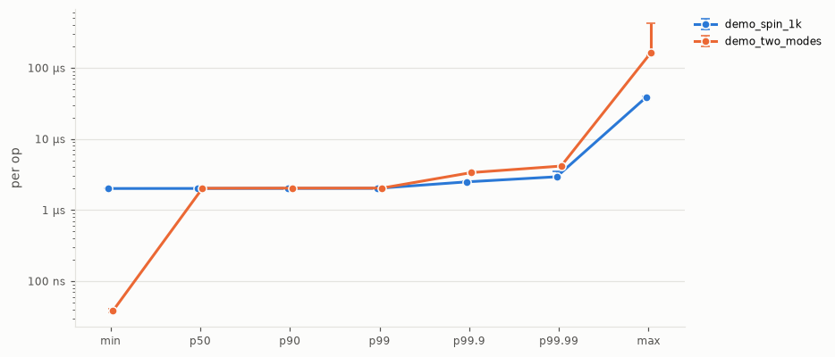

### 10 to 100 µs

### 100 to 1000 µs

### 1 to 10 ms

## Cases

<code>demo_spin_1</code>

Each repetition's figures and its stamp cost per batch. A case that drifted also shows the p50 of each tenth of each repetition, in time order.

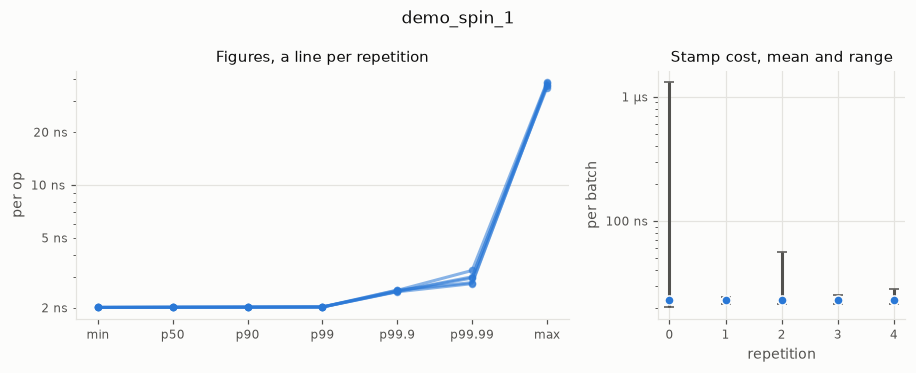

14.0 instructions per op, 0.43 cycles per instruction, held at 1.11 of the reference clock. A line per repetition through its batches by rank, between each pair of figures.

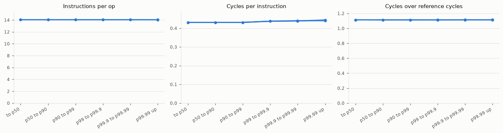

<code>demo_spin_10</code>

Each repetition's figures and its stamp cost per batch. A case that drifted also shows the p50 of each tenth of each repetition, in time order.

95.6 instructions per op, 0.64 cycles per instruction, held at 1.11 of the reference clock. A line per repetition through its batches by rank, between each pair of figures.

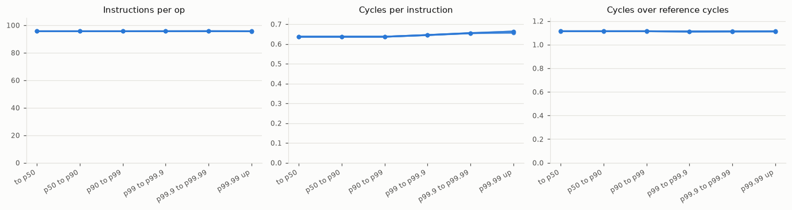

<code>demo_stall</code>

Each repetition's figures and its stamp cost per batch. A case that drifted also shows the p50 of each tenth of each repetition, in time order.

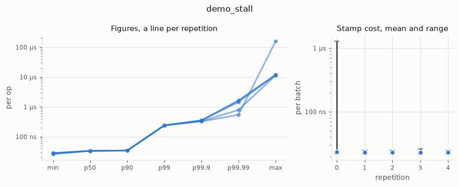

205.5 instructions per op, 1.32 cycles per instruction, held at 1.14 of the reference clock. A line per repetition through its batches by rank, between each pair of figures.

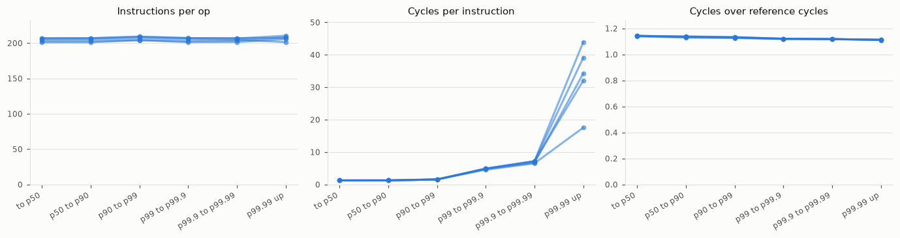

<code>demo_spin_100</code>

Each repetition's figures and its stamp cost per batch. A case that drifted also shows the p50 of each tenth of each repetition, in time order.

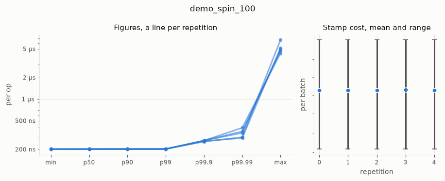

1,117.1 instructions per op, 0.54 cycles per instruction, held at 1.11 of the reference clock. A line per repetition through its batches by rank, between each pair of figures.

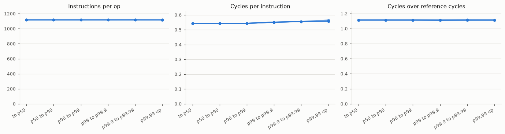

<code>demo_spin_1k</code>

Each repetition's figures and its stamp cost per batch. A case that drifted also shows the p50 of each tenth of each repetition, in time order.

11,051.7 instructions per op, 0.55 cycles per instruction, held at 1.11 of the reference clock. A line per repetition through its batches by rank, between each pair of figures.

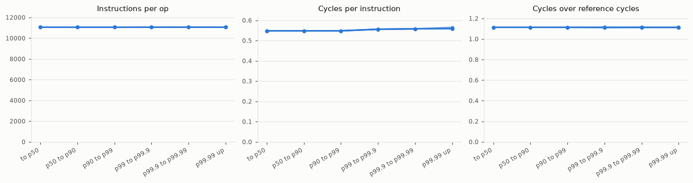

<code>demo_two_modes</code>

Each repetition's figures and its stamp cost per batch. A case that drifted also shows the p50 of each tenth of each repetition, in time order.

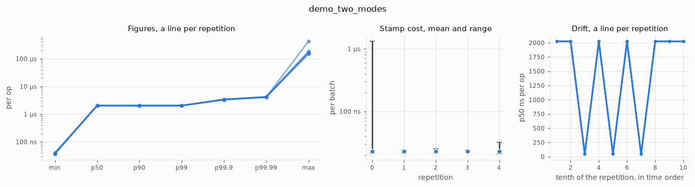

6,248.7 instructions per op, 0.52 cycles per instruction, held at 1.11 of the reference clock. A line per repetition through its batches by rank, between each pair of figures.

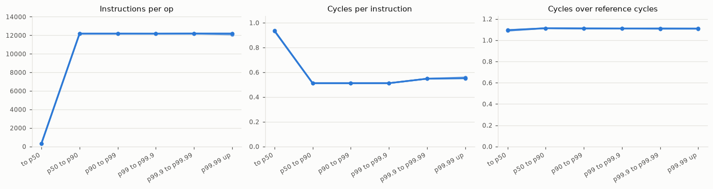

<code>demo_spin_10k</code>

Each repetition's figures and its stamp cost per batch. A case that drifted also shows the p50 of each tenth of each repetition, in time order.

110,171.7 instructions per op, 0.55 cycles per instruction, held at 1.11 of the reference clock. A line per repetition through its batches by rank, between each pair of figures.

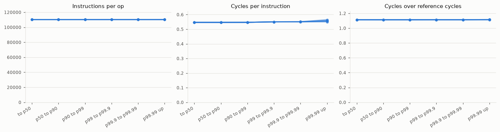

<code>demo_spin_100k</code>

Each repetition's figures and its stamp cost per batch. A case that drifted also shows the p50 of each tenth of each repetition, in time order.

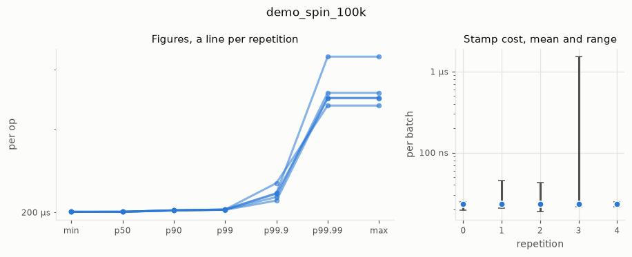

1,100,173.0 instructions per op, 0.55 cycles per instruction, held at 1.11 of the reference clock. A line per repetition through its batches by rank, between each pair of figures.

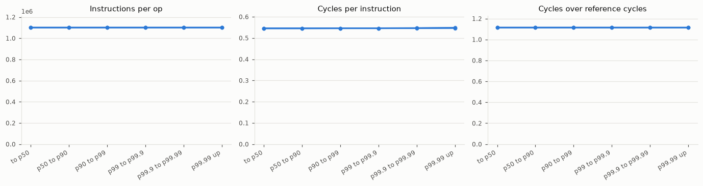

<code>demo_spin_1m</code>

Each repetition's figures and its stamp cost per batch. A case that drifted also shows the p50 of each tenth of each repetition, in time order.

11,000,156.1 instructions per op, 0.55 cycles per instruction, held at 1.11 of the reference clock. A line per repetition through its batches by rank, between each pair of figures.

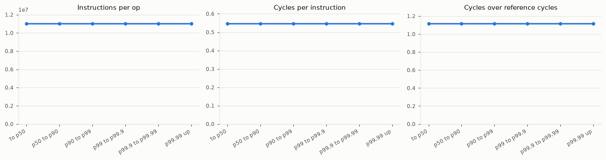

