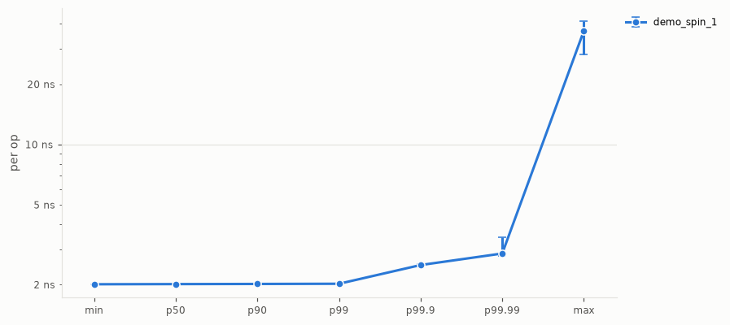
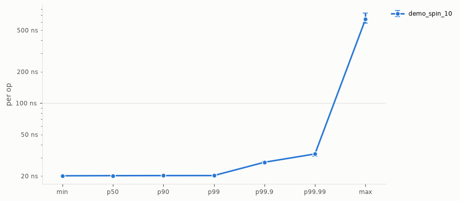
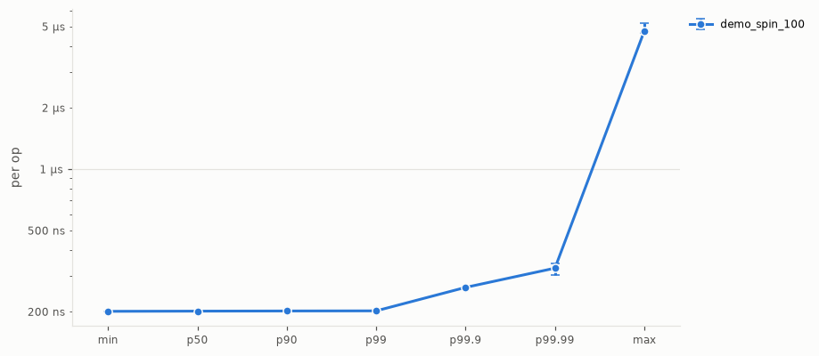
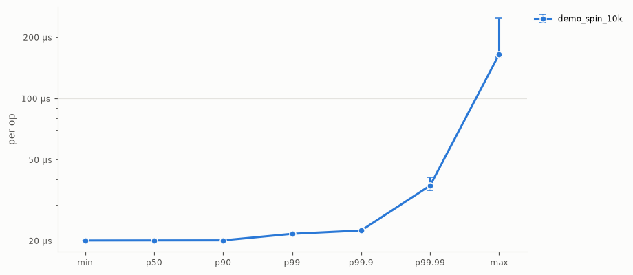
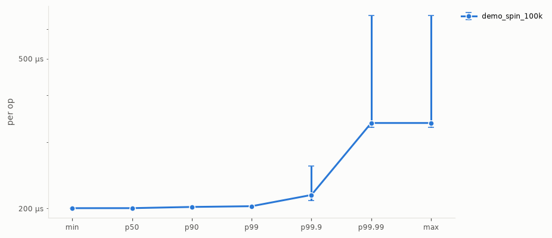
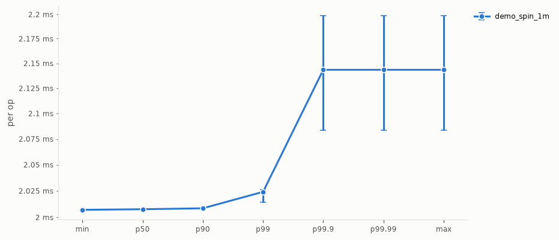
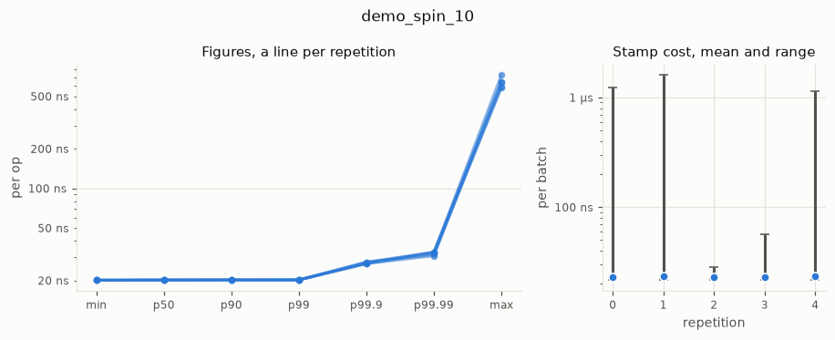
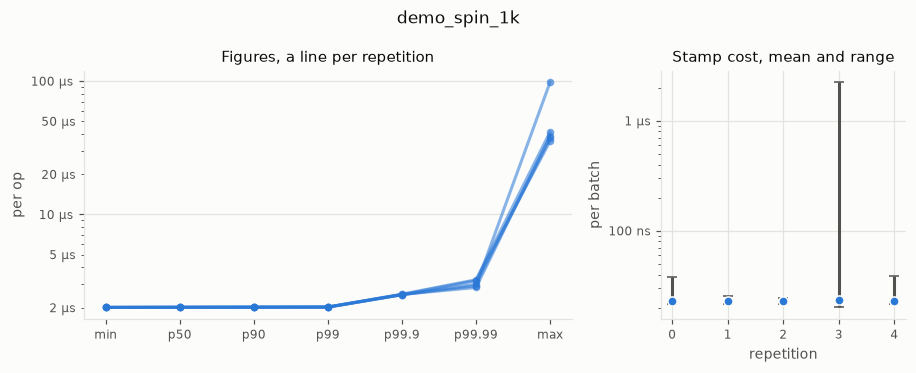
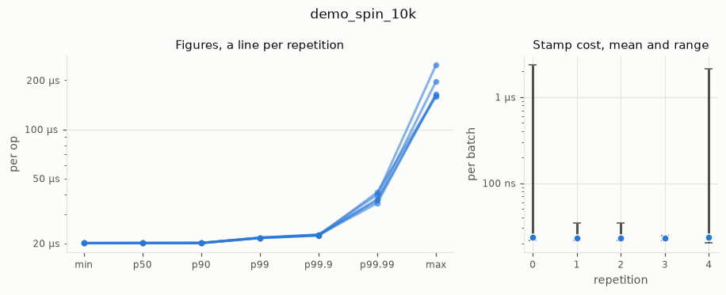
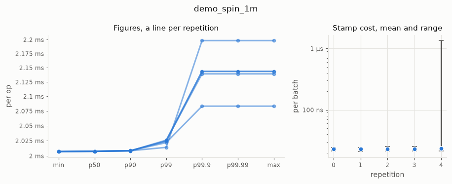

# Benchmarks

These cases are dummies, dependent xorshift steps from one to a million an op. They exist to show what a report looks like.

- Commit: `4c3e2cc-dirty`
- Run: 2026-11-25T11:45:03Z, 5 rounds, seed 9241013061082018195
- TSC: 2.688 GHz, invariant
- Figures: nanoseconds per op, the median across repetitions and their range

## Warnings

- Repetitions that moved CPU: `demo_spin_1` 2 of 5, `demo_spin_10` 3 of 5, `demo_spin_100` 2 of 5, `demo_spin_100k` 2 of 5, `demo_spin_10k` 1 of 5, `demo_spin_1k` 3 of 5, `demo_two_modes` 3 of 5.
- `demo_two_modes` drifted 97.8% within a repetition, over 5.0%.

## Summary

| Case | p50 | p90 | p99 | Spread | Drift | Stamp | Reps | Voids |
|---|--:|--:|--:|--:|--:|--:|--:|--:|
| `demo_spin_1` | 2.01 (2.01 to 2.01) | 2.01 (2.01 to 2.01) | 2.02 (2.02 to 2.02) | 0.01% | 0.01% | 0.28% | 5 | 0 |
| `demo_spin_10` | 20.1 (20.1 to 20.1) | 20.2 (20.2 to 20.2) | 20.2 (20.2 to 20.2) | 0.00% | 0.00% | 0.45% | 5 | 0 |
| `demo_spin_100` | 201 (201 to 201) | 202 (202 to 202) | 202 (202 to 202) | 0.00% | 0.00% | 0.36% | 5 | 0 |
| `demo_spin_1k` | 2,011 (2,011 to 2,011) | 2,014 (2,014 to 2,014) | 2,018 (2,015 to 2,019) | 0.00% | 0.01% | 0.29% | 5 | 0 |
| `demo_two_modes` | 2,024 (2,024 to 2,024) | 2,032 (2,032 to 2,032) | 2,033 (2,033 to 2,033) | 0.00% | **97.8%** | 1.1% | 5 | 0 |
| `demo_spin_10k` | 20,071 (20,071 to 20,071) | 20,086 (20,086 to 20,086) | 21,626 (21,515 to 21,653) | 0.00% | 0.00% | 0.12% | 5 | 0 |
| `demo_spin_100k` | 200,495 (200,495 to 200,496) | 201,965 (201,883 to 201,987) | 202,878 (202,714 to 202,921) | 0.00% | 0.00% | 0.01% | 5 | 0 |
| `demo_spin_1m` | 2,007,577 (2,007,505 to 2,007,594) | 2,008,452 (2,008,244 to 2,008,555) | 2,024,046 (2,014,007 to 2,025,971) | 0.00% | 0.02% | 0.00% | 5 | 0 |

Spread is the range of the repetition p50s over their median. Drift is the furthest a tenth of a repetition's p50 sits from the whole repetition's. Stamp is the stamp cost's share of a batch at p50.

## Overview

Each point is the median across repetitions, its bar from the lowest to the highest.

### 1 to 10 ns

### 10 to 100 ns

### 100 to 1000 ns

### 1 to 10 µs

### 10 to 100 µs

### 100 to 1000 µs

### 1 to 10 ms

## Cases

<code>demo_spin_1</code>

Each repetition's figures and its stamp cost per batch. A case that drifted also shows the p50 of each tenth of each repetition, in time order.

<code>demo_spin_10</code>

Each repetition's figures and its stamp cost per batch. A case that drifted also shows the p50 of each tenth of each repetition, in time order.

<code>demo_spin_100</code>

Each repetition's figures and its stamp cost per batch. A case that drifted also shows the p50 of each tenth of each repetition, in time order.

<code>demo_spin_1k</code>

Each repetition's figures and its stamp cost per batch. A case that drifted also shows the p50 of each tenth of each repetition, in time order.

<code>demo_two_modes</code>

Each repetition's figures and its stamp cost per batch. A case that drifted also shows the p50 of each tenth of each repetition, in time order.

<code>demo_spin_10k</code>

Each repetition's figures and its stamp cost per batch. A case that drifted also shows the p50 of each tenth of each repetition, in time order.

<code>demo_spin_100k</code>

Each repetition's figures and its stamp cost per batch. A case that drifted also shows the p50 of each tenth of each repetition, in time order.

<code>demo_spin_1m</code>

Each repetition's figures and its stamp cost per batch. A case that drifted also shows the p50 of each tenth of each repetition, in time order.

